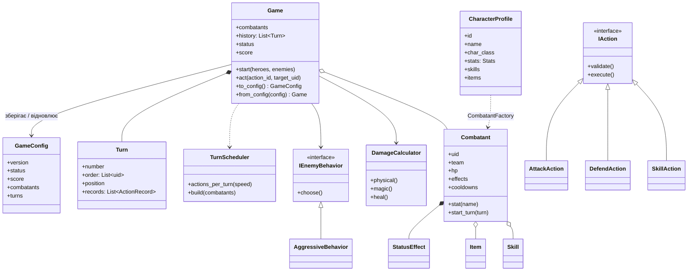
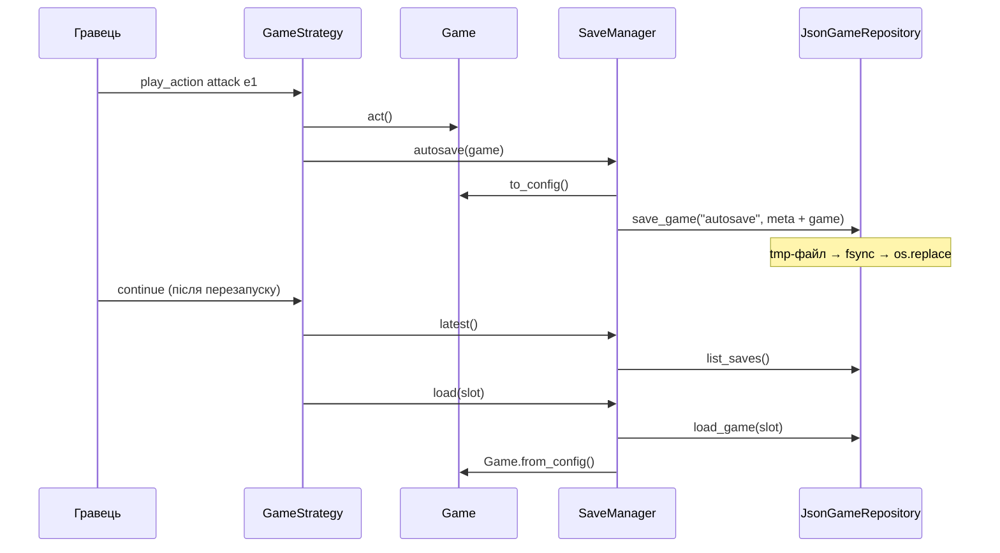
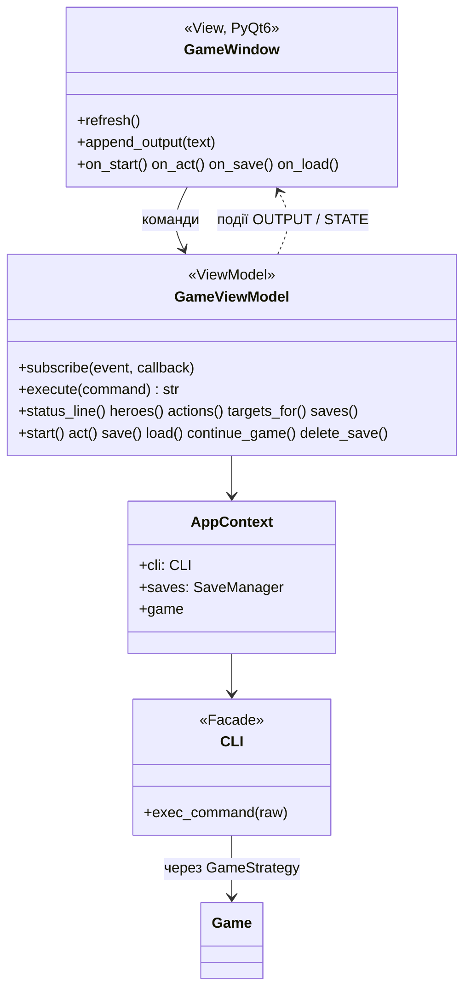
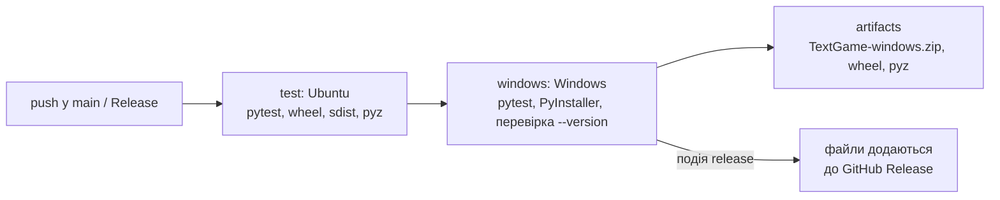
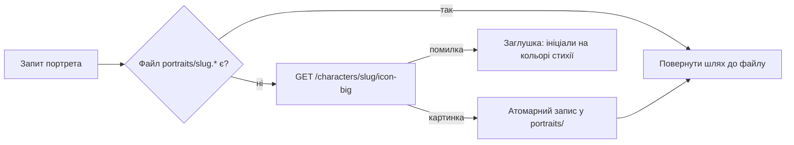
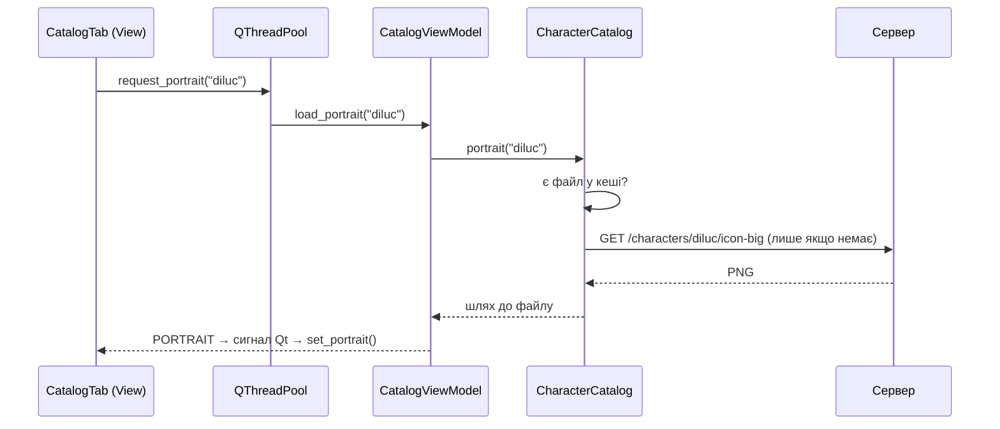

# Дизайн-документ проєкту «Текстова гра»

**Практичні заняття 14–18. Бізнес-логіка, постійність інформації, графічний інтерфейс, розгортання і фіналізація проєкту**
Версія застосунку: 1.1.0
Репозиторій: https://github.com/ssvmaqwe/OOP_Practice_18
Виконала: Фізик Анна, група КН-33, 3 курс

---

## 1. Архітектура системи

Проєкт побудований на тришаровій архітектурі. Шар представлення має два варіанти: консоль (`CLI/`) і графічне вікно (`GUI/`).

| Шар | Папка | Відповідальність |
|---|---|---|
| Представлення | `CLI/` | Парсинг команд, виведення результатів, патерни Фасад, Стратегія, Команда |
| Представлення (графіка) | `GUI/` | Вікно на PyQt6 (вкладки «Гра» і «Каталог персонажів») і ViewModel (MVVM), що працюють через той самий CLI |
| **Бізнес-логіка** | `Core/` | Правила гри, формули шкоди, покрокова система, моделі персонажів |
| Інфраструктура | `Infra/` | Збереження у системній папці даних (JSON-файли), кеш каталогу і портретів, отримання даних і картинок з API, консольна графіка |

Головне правило: **`Core` не імпортує нічого з `CLI` та `Infra`**. Ядро лише оголошує інтерфейси (`Core/interfaces.py`), а інші шари їх реалізують:

| Інтерфейс у Core | Реалізація | Шар |
|---|---|---|
| `IRenderer`, `IRenderable` | `ProfileConsoleRenderer`, `GameConsoleRenderer`, `CombatantConsoleRenderer` | Infra |
| `ICharacterSource` | `GenshinApiSource`, `StubCharacterSource`, `FallbackCharacterSource` | Infra |
| `IProfileRepository`, `IGameRepository` | `JsonProfileRepository`, `JsonGameRepository` (через `JsonFileStore`) | Infra |
| `IImageSource` | `GenshinApiSource`, `NoImageSource` | Infra |
| `ICatalogRepository`, `IPortraitStore` | `JsonCatalogRepository`, `FilePortraitStore` | Infra |

У практичній 13 інтерфейси `IRenderable`/`IRenderer` лежали в `CLI/presenter.py`, і `Core` імпортував їх із шару представлення. Тепер вони перенесені в `Core/interfaces.py`, а `CLI` лише використовує їх. Так залежності йдуть тільки в бік ядра (принцип інверсії залежностей).

## 2. Структура бізнес-шару

| Файл | Класи | Призначення |
|---|---|---|
| `stats.py` | `Stats`, `Modifier`, `StatusEffect`, `Item` | Характеристики, модифікатори, баффи/дебаффи, предмети |
| `skills.py` | `Skill`, `SkillLibrary` | Навички та набори навичок для кожного класу |
| `characters.py` | `CharacterProfile`, `CharacterManager`, `ApiProfileMapper`, `CharacterService` | Каталог персонажів, перетворення відповіді API у профіль |
| `combatant.py` | `Combatant`, `CombatantFactory`, `EnemyLibrary` | Модель учасника бою, створення героїв і ворогів |
| `combat.py` | `DamageCalculator`, `DamageReport` | Формули шкоди та лікування |
| `actions.py` | `IAction`, `AttackAction`, `DefendAction`, `SkillAction`, `ActionResolver`, `ActionRecord` | Дії учасників (патерн Команда) |
| `ai.py` | `IEnemyBehavior`, `AggressiveBehavior` | Поведінка ворогів (патерн Стратегія) |
| `game.py` | `Game`, `GameConfig`, `Turn`, `TurnScheduler`, `GameStatus` | Основний цикл гри, кроки, знімок стану |
| `saves.py` | `SaveManager`, `SaveInfo`, `ProfileStorage`, `migrate_legacy` | Правила збереження: слоти, автозбереження, «останній сейв», персонажі користувача |
| `catalog.py` | `CatalogEntry`, `CatalogParser`, `CharacterCatalog`, `RefreshResult` | Каталог усіх персонажів з API: парсинг JSON, оновлення, кеш портретів (розділ 14) |

### 2.1. Діаграма класів



### 2.2. Шлях даних

```
API / characters.json  →  CharacterProfile  →  CombatantFactory  →  Combatant  →  Game
                                                                                ↓
                    saves/<слот>.json  ←  SaveManager  ←  GameConfig  ←  to_config()
```

`CharacterProfile` — це «паспорт» персонажа, який зберігається в каталозі (власний персонаж або завантажений з API). Під час старту бою з нього створюється `Combatant` — окремий об'єкт із поточним HP, ефектами та перезарядками. Тому бій не змінює дані в каталозі.

## 3. Характеристики персонажа

| Характеристика | Поле | Опис |
|---|---|---|
| Health | `health` | Максимальне здоров'я |
| Damage | `damage` | Базова фізична шкода (`dmg_flat` для фізичної атаки) |
| Magic | `magic` | Базова магічна шкода (`dmg_flat` для магії) |
| Armor (flat defense) | `armor` | Скільки фізичної шкоди блокується напряму |
| Resist | `resist` | Частка шкоди, що ігнорується (0.2 = 20%) |
| Resistance penetration | `res_pen` | Частка резисту цілі, яку атака ігнорує |
| Speed | `speed` | Скільки дій і в якому порядку персонаж робить за крок |

### 3.1. Модифікатори

Кожен предмет і кожен ефект містить список `Modifier(stat, value)`.

* Якщо `stat` — одна з характеристик вище, значення **додається** до неї.
* `power` — відсоткове підсилення всієї шкоди (`0.3` = +30%).
* `weaken` — відсоткове ослаблення шкоди від дебаффу (`0.3` = −30%).

Ефективне значення характеристики:

```
stat_eff = stat_base + Σ modifier(stat)  (з предметів і активних ефектів)
```

## 4. Формули

### 4.1. Допоміжні величини

```
bonus_flat  = Σ (bonus_item + bonus_skill + bonus_buff)     — пласкі бонуси до шкоди
bonus_prof  = 1 + Σ power                                    — множник підсилень
dmg_ability = Σ weaken                                        — ослаблення від дебаффів
res_mult    = max(0, 1 − res_tgt + res_pen)                  — множник резисту
pow_mult    = max(0, bonus_prof − dmg_ability)               — підсумковий множник
```

`res_pen` складається з характеристики атакуючого та бонусу навички (наприклад, «Пробивний постріл» дає +0.4).

### 4.2. Фізична атака

```
after_armor = dmg_flat + bonus_flat − armor_tgt
якщо after_armor ≤ 0  →  шкода = 0 (броня повністю перекрила удар)
інакше  dmg_phys = round( after_armor × res_mult × pow_mult )
```

Спочатку від чистої шкоди віднімається броня. Якщо результат менший або дорівнює нулю, атака нічого не пробила. Якщо атака пройшла крізь броню, застосовується модифікатор резисту, зважений відносно одиниці (100%), а потім множник бонусів.

### 4.3. Магічна атака

Магія **ігнорує броню**, але на неї краще працюють резисти:

```
dmg_magic = round( (dmg_flat × max(0, 1 − res_tgt + res_pen) + bonus_flat) × max(0, bonus_prof − dmg_ability) )
```

### 4.4. Лікування

```
heal = round( (skill_power + magic × 0.5) × bonus_prof )
```

Лікування не може підняти HP вище максимуму.

### 4.5. Приклади розрахунків

| Ситуація | Розрахунок | Результат |
|---|---|---|
| Артур (шкода 24, меч +6) атакує Гобліна (броня 4, резист 10%) | (24 + 6 − 4) × 0.9 × 1.0 = 23.4 | **23** |
| Те саме, навичка «Потужний удар» (+15) | (24 + 6 + 15 − 4) × 0.9 = 36.9 | **37** |
| «Потужний удар» під «Бойовим кличем» (+30%) | 41 × 0.9 × 1.3 = 47.97 | **48** |
| Мерлін (магія 22, посох +5 магії і +10%, res_pen 0.1) — «Вогняна куля» (+20) по Слизовому магу (резист 30%) | (22 × 0.8 + 25) × 1.1 = 46.86 | **47** |
| Мерлін (шкода 10) б'є Орка (броня 10) звичайною атакою | 10 − 10 = 0 | **0, блок** |

Ці значення перевіряються автоматичними тестами в `Tests/test_core.py`.

## 5. Покрокова система

### 5.1. Крок (Turn)

Бій складається з послідовності кроків. Кожен крок — окремий об'єкт `Turn`, який зберігає:

* номер кроку;
* порядок дій (`order`) — список ідентифікаторів учасників;
* позицію поточного учасника;
* журнал дій (`records`).

Інкапсуляція кроку в окремий клас потрібна, щоб легко переглядати історію бою (`play_history`) та щоб спростити підрахунок порядку дій і їх кількості.

### 5.2. Швидкість і порядок дій

`TurnScheduler` будує порядок на початку кожного кроку:

```
кількість дій = max(1, speed // 100)
час i-ї дії   = i / кількість дій      (i = 0, 1, ...)
сортування    за часом, потім за швидкістю (більша — раніше)
```

| Швидкість | Дій за крок | Коли ходить |
|---|---|---|
| 100 | 1 | на початку кроку, після швидших |
| 150 | 1 | перед персонажем зі швидкістю 100 |
| 200 | 2 | першим, і ще раз посередині кроку |
| 300 | 3 | на початку, на 1/3 та на 2/3 кроку |

Приклад зі швидкостями 200, 150, 100: `200 → 150 → 100 → 200`.

Швидкість можуть змінювати ефекти (наприклад, «Липкість» дає −40), тому порядок перераховується для кожного нового кроку.

### 5.3. Початок дії учасника

Коли учасник уперше ходить у новому кроці:

1. Перезарядки всіх його навичок зменшуються на 1.
2. Спрацьовують ефекти з `hp_per_turn` (отрута, опік — шкода; благословення — лікування).
3. Тривалість кожного ефекту зменшується на 1; ефекти з тривалістю 0 знімаються.

Ефект, накладений у поточному кроці, не зменшується в цьому ж кроці. Тому «тривалість 2» означає два наступні кроки цілі.

### 5.4. Дії гравця

| Дія | Ціль | Опис |
|---|---|---|
| `attack` | ворог | Звичайна фізична атака |
| `defend` | себе | +10 броні та +20% резисту до свого наступного кроку |
| `<skill_id>` | залежить від навички | Використання навички класу |

Якщо ціль не вказана: для атаки береться перший живий ворог, для лікування і баффів союзнику — союзник із найменшою часткою HP, для баффів на себе — сам персонаж.

### 5.5. Навички класів

| Клас | Навички |
|---|---|
| Воїн | Потужний удар (фізична +15, перезарядка 2), Бойовий клич (+30% шкоди на 2 кроки, перезарядка 4) |
| Маг | Вогняна куля (магічна +20 і опік 5 HP/крок, перезарядка 3), Прокляття (−30% шкоди і −15% резисту цілі, перезарядка 4) |
| Цілитель | Лікування (30 + 0.5 × магія, перезарядка 2), Благословення (+8 броні і +5 HP/крок на 3 кроки, перезарядка 4) |
| Лучник | Пробивний постріл (+8, ігнорує 40% резисту), Отруйна стріла (+5 і отрута 6 HP/крок на 3 кроки) |

### 5.6. Вороги

| ID | Назва | HP | Шкода | Магія | Броня | Резист | Швидкість | Навички |
|---|---|---|---|---|---|---|---|---|
| goblin | Гоблін | 90 | 18 | 0 | 4 | 10% | 120 | Розмашистий удар |
| slime | Слизовий маг | 70 | 8 | 20 | 2 | 30% | 90 | Слизовий заряд |
| wolf | Лютий вовк | 70 | 14 | 0 | 1 | 0% | 200 | — |
| orc | Орк-вождь | 160 | 24 | 0 | 10 | 5% | 80 | Розмашистий удар, Бойовий клич |

Поведінка ворогів (`AggressiveBehavior`): ворог обирає героя з найменшим HP. Він використовує першу готову навичку: бафф на себе, якщо його ще немає, або атакувальну навичку. Якщо всі навички на перезарядці — звичайна атака.

### 5.7. Завершення гри і рахунок

* **Перемога** — усі вороги переможені; **поразка** — усі герої переможені.
* Очки = шкода героїв по ворогах × 10.
* Бонус за перемогу = max(0, 500 − 20 × номер кроку).

## 6. Постійність інформації (збереження і завантаження)

### 6.1. Що зберігається

| Дані | Файл | Коли записується |
|---|---|---|
| Персонажі, створені користувачем (`create`) або імпортовані з API (`import`) | `characters.json` | Одразу після створення, імпорту чи видалення |
| Стан гри | `saves/autosave.json` | Автоматично після старту бою, після кожної дії гравця і при виході з програми |
| Стан гри в іменованому слоті | `saves/<слот>.json` | Командою `game_save <слот>` |
| Кеш каталогу персонажів з API | `catalog.json` | Після кожного оновлення каталогу (розділ 14) |
| Портрети персонажів | `portraits/<slug>.png` (або `.webp`, `.jpg`) | Після першого завантаження картинки з сервера |

Вбудованих персонажів (Артур, Мерлін, Ліра) у файл не записуємо: вони є частиною коду й завжди створюються під час запуску. Так файл містить лише дані користувача, і зміна балансу вбудованих героїв не конфліктує зі старими файлами.

### 6.2. Де зберігається

Дані не записуються в папку з програмою, а лежать у стандартній системній папці для даних додатків (`AppDataLocator`):

| ОС | Папка |
|---|---|
| Windows | `%APPDATA%\OOPTextGame` (тобто `C:\Users\<ім'я>\AppData\Roaming\OOPTextGame`) |
| Linux | `$XDG_DATA_HOME/oop-text-game`, типово `~/.local/share/oop-text-game` |
| macOS | `~/Library/Application Support/OOPTextGame` |

На Linux обрано `~/.local/share`, а не `/usr/share` чи `/usr/local`: ті папки спільні для всієї системи, і писати туди звичайному користувачу без прав адміністратора не можна. Папку можна перевизначити змінною `OOP_GAME_HOME` або параметром `--data-dir=...`; це зручно для тестів і для перенесення збережень. Команда `storage` показує, де саме лежать дані.

### 6.3. Формат файлів

Обрано **JSON**: він компактний, підтримується стандартною бібліотекою Python (`json`), його легко прочитати очима, і стан гри вже вміє перетворюватись у словник (`to_dict` / `from_dict`). XML дає багато службового тексту, а YAML потребує сторонньої бібліотеки й чутливий до відступів, тому для збережень вони гірші.

Кожен файл загорнутий у «конверт» з описом:

```json
{
  "format": "oop-text-game",
  "version": 3,
  "kind": "save",
  "written_at": "2026-11-24T14:36:38",
  "data": {
    "meta": { "slot": "autosave", "saved_at": "...", "turn": 2, "status": "active", "score": 370, "heroes": ["Артур", "Лицар"] },
    "game": { "version": 2, "status": "active", "score": 370, "combatants": [ ... ], "turns": [ ... ] }
  }
}
```

* `format` і `kind` не дають випадково прочитати чужий файл або файл персонажів як збереження.
* `version` дозволяє в майбутньому змінювати формат і розпізнавати старі файли.
* `meta` — короткий опис збереження. Команда `saves` показує список, не відновлюючи кожну гру повністю.
* `game` — повний знімок `GameConfig` з практичної 14: учасники з HP, ефектами, перезарядками, усі кроки з історією та позиція поточного ходу.

### 6.4. Надійність

* **Атомарний запис.** Спочатку дані пишуться у тимчасовий файл `*.tmp`, потім `os.fsync` скидає їх на диск, і `os.replace` одним кроком замінює старий файл. Якщо програма впаде посеред запису, попереднє збереження залишиться цілим.
* **Пошкоджені файли.** Якщо файл не читається (зламаний JSON, чужий формат, новіша версія), він перейменовується на `*.corrupt`, а користувач бачить попередження. Програма не падає, а пошкоджений файл можна відкрити вручну.
* **Безпечні назви слотів.** Назва слоту — лише латинські літери, цифри, `_` і `-`, до 32 символів. Тому `game_save ../hack` не зможе записати файл поза папкою `saves`.
* **Помилки диска.** Помилки запису (`OSError`) перехоплюються в CLI, і користувач отримує повідомлення замість аварійного завершення.

### 6.5. «Останній сейв» і продовження гри

`SaveManager.latest()` повертає збереження з найпізнішим часом `saved_at` серед усіх слотів, і автоматичного, і ручних. Під час запуску програма показує, яке збереження знайдено, а команда `continue` (або `game_load` без параметрів) відновлює саме його. Оскільки автозбереження робиться після кожної дії, гра продовжується рівно з того ходу, на якому користувач вийшов, навіть якщо він закрив програму без `game_save`.



### 6.6. Розподіл відповідальності

* **Core** (`SaveManager`, `ProfileStorage`) вирішує, *що* і *коли* зберігати: назви слотів, автозбереження, вибір останнього сейву, які персонажі належать користувачу. Ядро працює через інтерфейси `IGameRepository` / `IProfileRepository` і не знає про файли.
* **Infra** (`JsonFileStore`, `JsonGameRepository`, `JsonProfileRepository`, `AppDataLocator`) вирішує, *де* і *як* записати: шлях до папки, формат JSON, атомарність, обробку пошкоджених файлів. Щоб перейти, наприклад, на SQLite, достатньо написати нову реалізацію репозиторіїв; бізнес-логіку змінювати не потрібно.

### 6.7. Перехід зі старої версії

У практичних 13–14 усе лежало в одному файлі `repository.json` поруч із програмою. Якщо такий файл знайдено під час запуску:

1. Персонажі з нього переносяться до `characters.json`; ті, що збігаються з вбудованими за ID, пропускаються.
2. Збереження гри формату практичної 14 (`version: 2`) переноситься у слот `imported`. Стан практичної 13 мав інший формат без версії, тож переноситься лише список персонажів, і користувач бачить про це повідомлення.
3. Файл перейменовується на `repository.json.migrated`, щоб перенесення не повторювалось.

## 7. Завантаження нових персонажів

1. `CharacterService.import_character(name)` отримує сирий JSON через `ICharacterSource`.
2. `ApiProfileMapper.from_api()` перетворює його у `CharacterProfile`:

| Поле API | Що визначає |
|---|---|
| `rarity` | HP = 80 + 10·r, шкода = 8 + 3·r, броня = 2·r, резист = min(25%, 4%·r) |
| `vision` | Клас: Pyro/Electro → Маг, Hydro/Dendro → Цілитель, Geo → Воїн, Anemo/Cryo → Лучник |
| `weapon` | Швидкість: Bow 120, Sword 110, Polearm 105, Catalyst 100, Claymore 85; дворучна зброя дає +4 броні |

3. Профіль додається в каталог і може брати участь у бою.

Джерело даних — `FallbackCharacterSource`: спочатку запит до `https://genshin.jmp.blue`, а якщо сервер недоступний — **заглушка** `StubCharacterSource` з тестовими даними (diluc, venti, zhongli, barbara, fischl). Так компонент працює і без мережі.

Також можна створити власного персонажа командою `create`. Створені та імпортовані персонажі зберігаються автоматично (див. розділ 6). Старий формат персонажів (`hp`, `attack`) з практичної 13 автоматично перетворюється у нові характеристики.

## 8. Використані патерни

| Патерн | Де |
|---|---|
| Фабрика | `CombatantFactory` — створення учасників бою з профілю або шаблону ворога |
| Команда | `IAction` і нащадки — кожна дія є окремим об'єктом із `validate` / `execute` |
| Стратегія | `IEnemyBehavior` — поведінку ворогів можна замінити, не змінюючи `Game` |
| Знімок (Memento) | `GameConfig` — збереження й відновлення стану гри |
| Репозиторій | `IGameRepository`, `IProfileRepository` — ядро не знає, де і як лежать файли |
| Сервісний шар | `SaveManager`, `ProfileStorage` — правила збереження окремо від файлової системи |
| Адаптер / Маппер | `ApiProfileMapper` — перетворення відповіді API у доменну модель |
| Замісник (заглушка) | `StubCharacterSource`, `FallbackCharacterSource` |
| Інверсія залежностей | Інтерфейси в `Core/interfaces.py`, реалізації в `Infra` |
| Кеш (буферизація) | `CharacterCatalog` + `FilePortraitStore` — повторні запити до сервера не виконуються |
| Пул потоків | `ThreadPoolExecutor` у `CharacterCatalog`, `QThreadPool` у вкладці каталогу |
| Фасад, Стратегія, Команда (CLI) | `CLI`, `CatalogStrategy`, `RosterStrategy`, `GameStrategy`, `SystemStrategy` |
| MVVM | `GameWindow`, `CatalogTab` (View), `GameViewModel`, `CatalogViewModel` (ViewModel), `Core` (Model) |
| Спостерігач | Події `OUTPUT` / `STATE` / `CARDS` / `PORTRAIT` / `PROGRESS` у ViewModel, сигнали Qt |

## 9. Команди

| Команда | Опис |
|---|---|
| `catalog [пошук] [--refresh]` | Усі персонажі з API: ім'я, рідкість, стихія, зброя, регіон, посилання на графіку |
| `catalog_refresh` | Оновити каталог з сервера |
| `catalog_show <slug>` | Загальна інформація, URL графіки і шлях до локального портрета |
| `portraits [slug…] [--all]` | Завантажити портрети в локальний кеш |
| `catalog_add <slug>` | Додати персонажа з каталогу у гру |
| `list`, `show <id>` | Персонажі, доступні для гри |
| `create` | Створити власного персонажа (одразу зберігається) |
| `delete <id>` | Видалити власного персонажа |
| `import <name>`, `sources` | Завантажити персонажа з API |
| `save` | Примусово зберегти каталог |
| `play_start <id> [<id>...] [--enemies=goblin,wolf]` | Почати бій (кілька героїв, вибір ворогів) |
| `play_action <дія> [ціль]` | Дія поточного героя, напр. `play_action fireball e2` |
| `play_status` | Стан бою, порядок ходів, доступні дії |
| `play_history [--last=N]` | Історія кроків |
| `continue` | Продовжити з останнього збереження |
| `game_save [слот]`, `game_load [слот]` | Збереження в слот і завантаження зі слоту |
| `saves`, `save_delete <слот>` | Список збережень, видалення збереження |
| `storage` | Показати папку з даними |
| `enemies`, `skills` | Довідники ворогів і навичок |

У графічному вікні ці ж команди доступні через кнопки (розділ 11), а будь-яку з них можна ввести в рядку команди.

Приклад сесії:

```
> catalog
> catalog_show diluc
> catalog_add diluc
> play_start warrior_1 mage_1 --enemies=goblin,wolf
> play_action fireball e2
> play_action war_cry
> play_action strike e1
> play_history
> game_save before_boss
> exit

(новий запуск)
> continue
```

## 10. Тестування

Запуск: `python -m pytest`

* `Tests/test_core.py` — формули шкоди (броня, резист, пробиття, бонуси, дебаффи, магія), порядок ходів за швидкістю, ефекти, перезарядки, повний бій до перемоги, недопустимі дії, збереження й відновлення, маппер API, старий формат даних.
* `Tests/test_storage.py` — вибір системної папки для Windows/Linux/macOS, формат файлу, атомарний запис, обробка пошкодженого файлу, збереження і відновлення гри, «останній сейв», помилки слотів, запис лише власних персонажів, міграція старого `repository.json`.
* `Tests/test_cli.py` — парсер аргументів, продовження гри після «перезапуску» (`continue`), ручні слоти, захист від небезпечних назв слотів, створення і видалення персонажа зі збереженням між запусками.

* `Tests/test_viewmodel.py` — ViewModel графічного інтерфейсу: виведення тексту слухачам, списки героїв і ворогів, бій через кнопки, видимість перезарядки, перевірка вибору, кнопки збережень, «Продовжити останнє» після перезапуску, створення й імпорт героя, неправильна команда.

* `Tests/test_deploy.py` — параметри запуску, версія, режими Debug/Release, збирання і запуск `.pyz` (розділ 13.7).

* `Tests/test_catalog.py` — парсинг JSON з API (нормалізація, відсутні й неправильні поля), оновлення каталогу з пропуском пошкоджених записів, робота без мережі зі збереженого кешу, кеш портретів (повторного запиту немає), консольні команди каталогу.
* `Tests/test_catalog_viewmodel.py` — картки каталогу, прогрес оновлення, пошук, додавання персонажа у гру.
* `Tests/test_gui_smoke.py` — справжнє вікно PyQt6 у режимі `offscreen`: дві вкладки, картки з портретами, пошук, додавання героя. Виконується там, де встановлено PyQt6 (у GitHub Actions на Windows), а без PyQt6 пропускається.

Усього 52 тести. Тести бізнес-логіки й ViewModel не потребують PyQt6. Тести працюють у тимчасовій папці (`tmp_path`), тому не чіпають справжні збереження.

## 11. Графічний інтерфейс

### 11.1. Вибір технології

Обрано **PyQt6** — Python-обгортку над Qt, який методичка рекомендує для Python. Це нативний віконний інтерфейс: вікно і стандартні елементи (кнопки, списки, поля) малює Qt засобами операційної системи, тому програма запускається як звичайний застосунок Windows, Linux чи macOS. Вебверсію не обирали: їй потрібен окремий Web-API і клієнт-серверна архітектура, а для текстової гри це зайве.

Запуск: `pip install -r requirements.txt`, потім `python gui.py`. Консольна версія (`python main.py`) працює й надалі, і обидві використовують ті самі збереження.

### 11.2. Вигляд вікна

Вікно має дві вкладки (`QTabWidget`): «Гра» і «Каталог персонажів» (розділ 14.4). Вкладка «Гра» поділена на дві частини (`QSplitter`): ліворуч «консоль», праворуч панель керування.

```
┌───────────────────────────────────────────────┬──────────────────────────────────┐
│ > play_start warrior_1 --enemies=goblin,slime │ Триває | Крок 2 | Очки 230 |     │
│ ========================================      │ Ходить: Артур (h1)               │
│   ТЕКСТОВА ГРА                                │ ┌ Новий бій ───────────────────┐ │
│ ========================================      │ │ Герої:  [x] Артур — Воїн     │ │
│ [Крок 1] Гоблін використовує «Розмашистий     │ │         [ ] Мерлін — Маг     │ │
│ удар» на Артур: 18 фізичної шкоди             │ │ Вороги: [x] Гоблін  [x] Слиз │ │
│ ...                                           │ │ [Почати бій] [Створити героя…]│ │
│ > play_action attack e1                       │ │ [Імпорт з API…]              │ │
│ [Крок 1] Артур атакує Гоблін: 23 шкоди        │ └──────────────────────────────┘ │
│                                               │ ┌ Хід героя ───────────────────┐ │
│                                               │ │ Дія:  [Потужний удар     ▼]  │ │
│                                               │ │ Ціль: [Гоблін [e1] 67/90 ▼]  │ │
│                                               │ │ [Виконати дію]               │ │
│                                               │ │ [Статус] [Історія]           │ │
│                                               │ └──────────────────────────────┘ │
│                                               │ ┌ Збереження ──────────────────┐ │
│                                               │ │ autosave (авто) — крок 2 ... │ │
│                                               │ │ before_boss — крок 1 ...     │ │
│ [команда консолі...........] [Виконати]       │ │ [Завантажити] [Продовжити    │ │
│                              [Очистити]       │ │ останнє] [Зберегти як…]      │ │
│                                               │ │ [Видалити]                   │ │
├───────────────────────────────────────────────┴──────────────────────────────────┤
│ Дані гри: C:\Users\...\AppData\Roaming\OOPTextGame                               │
└──────────────────────────────────────────────────────────────────────────────────┘
```

| Елемент | Віджет Qt | Призначення |
|---|---|---|
| Консоль | `QPlainTextEdit` (лише читання, моноширинний шрифт) | Текстовий вивід основного циклу гри, як у терміналі |
| Рядок команди | `QLineEdit` + кнопка «Виконати» | Можна ввести будь-яку консольну команду (`enemies`, `skills`, `storage`…) |
| Рядок стану | `QLabel` | Статус бою, номер кроку, очки, хто зараз ходить |
| Герої / Вороги | `QListWidget` з прапорцями | Вибір учасників нового бою |
| Дія / Ціль | два `QComboBox` | Дії поточного героя. Навички на перезарядці показано неактивними, а список цілей залежить від обраної дії (ворог, союзник або сам герой) |
| Список збережень | `QListWidget` | Слот, час, крок, статус, герої. Подвійне клацання завантажує збереження |
| Кнопки збережень | `QPushButton` | «Завантажити», «Продовжити останнє», «Зберегти як…» (`QInputDialog`), «Видалити» (з підтвердженням `QMessageBox`) |
| «Створити героя…» | `QDialog` з `QFormLayout` і `QSpinBox` | Форма замість послідовних запитань консолі |
| Рядок стану вікна | `QStatusBar` | Шлях до папки з даними |

### 11.3. Архітектура: MVVM



* **Model** — уже наявні шари `Core` і `Infra` (гра, правила, збереження). Для GUI їх не змінювали.
* **ViewModel** (`GUI/viewmodel.py`) не імпортує Qt. Вона перетворює стан гри на прості дані для вікна (`HeroOption`, `ActionOption`, `TargetOption`, `SaveRow`) і приймає команди від кнопок. Кожна команда виконується через той самий фасад `CLI`, що й у консолі, а вивід перехоплюється (`contextlib.redirect_stdout`) і передається у вікно. Тому вікно справді є «аналогом консолі»: текст у ньому той самий, що й у терміналі.
* **View** (`GUI/window.py`) лише малює елементи й передає натискання у ViewModel.

Зв'язок у зворотний бік — через патерн **Спостерігач**: вікно підписується на дві події ViewModel:

| Подія | Коли виникає | Що робить вікно |
|---|---|---|
| `OUTPUT` | Після кожної команди | Додає текст у консоль і прокручує її донизу |
| `STATE` | Після кожної команди | Оновлює рядок стану, списки героїв, дій, цілей і збережень |

Сам Qt працює за **подієвою моделлю (event-driven)**: кнопки, рядок введення та списки мають сигнали (`clicked`, `returnPressed`, `currentIndexChanged`, `itemDoubleClicked`), до яких під'єднано обробники вікна.

### 11.4. Як це працює на прикладі

1. Гравець обирає дію «Потужний удар» і ціль «Гоблін», натискає «Виконати дію».
2. `GameWindow.on_act()` викликає `vm.act("strike", "e1")`.
3. ViewModel формує команду `play_action strike e1` і виконує її через `CLI`, перехоплюючи вивід.
4. `GameStrategy` виконує хід, вороги відповідають, спрацьовує автозбереження (розділ 6).
5. ViewModel надсилає `OUTPUT` з текстом ходу і `STATE`. Вікно дописує текст у консоль і оновлює списки: «Потужний удар» стає неактивним (перезарядка), а в списку збережень оновлюється `autosave`.

### 11.5. Створення героя з вікна

Консольна команда `create` питає дані через функцію `reader` (у консолі це `input`). Для GUI в `CatalogStrategy` передається `AnswerQueue`: вікно показує форму `CreateCharacterDialog`, ViewModel кладе всі відповіді в чергу, і `create` бере їх звідти. Бізнес-логіку створення та збереження персонажа не дублювали.

### 11.6. Спільний запуск

Створення всіх об'єктів (сховище, менеджер персонажів, `SaveManager`, CLI-стратегії) винесено в `app.py` (`build_app` → `AppContext`). Його використовують і `main.py`, і `gui.py`, тому обидва інтерфейси працюють з однаковими даними. Під час закриття вікна (`closeEvent`) гра автоматично зберігається.

## 12. Запуск

```
python gui.py                  — графічне вікно (потрібен PyQt6)
python main.py                 — консольний режим
python main.py continue        — одразу продовжити останню гру
python main.py --data-dir=./data   — тримати дані в іншій папці
python main.py --debug         — режим налагодження
python main.py --version       — версія
```

Папку даних також можна змінити змінною середовища `OOP_GAME_HOME`. Як встановити готову збірку, описано в розділі 13.

## 13. Розгортання

### 13.1. Обрані способи доставки

| Спосіб | Для кого | Що отримує користувач | Що потрібно на комп'ютері |
|---|---|---|---|
| **Скомпільовані файли (exe)** — основний | Звичайні користувачі Windows | `TextGame-windows.zip` у GitHub Release: `TextGame.exe` (вікно) і `TextGameConsole.exe` (консоль) | Нічого: інтерпретатор Python, PyQt6 і всі шари застосунку вже вбудовані в exe |
| **Пакет Python (wheel)** | Користувачі, у яких є Python, будь-яка ОС | `oop_text_game-1.1.0-py3-none-any.whl`, після встановлення команди `textgame` і `textgame-gui` | Python 3.10+; для вікна — PyQt6 (ставиться автоматично з `[gui]`) |
| **Один файл `.pyz`** | Швидкий запуск без встановлення | `textgame.pyz`, `textgame-gui.pyz` | Python 3.10+ (для вікна — PyQt6) |
| **Початковий код** | Розробники, перевірка роботи | Репозиторій GitHub | Python 3.10+, `requirements.txt` |

Інсталятор і маркет-платформи не використовували: для навчального застосунку без системних налаштувань достатньо архіву з exe, який працює одразу після розпакування («portable»-варіант).

### 13.2. Як застосунок поділений на частини

Шари проєкту залишаються окремими пакетами Python. Під час збирання вони об'єднуються в один виконуваний файл:

```
TextGame.exe / TextGameConsole.exe   ← точка входу (gui.py / main.py)
 ├─ інтерпретатор Python 3.12 + стандартна бібліотека
 ├─ app.py, version.py               ← складання застосунку, версія
 ├─ CLI/    ← шар представлення (консоль)
 ├─ GUI/    ← шар представлення (вікно, лише в TextGame.exe)
 ├─ Core/   ← бізнес-логіка
 ├─ Infra/  ← постійність, API, відображення
 └─ PyQt6 + бібліотеки Qt (лише в TextGame.exe)
```

| Файл | Точка входу | Режим | Розмір (орієнтовно) |
|---|---|---|---|
| `TextGame.exe` | `gui.py` | `--windowed`: без чорного вікна консолі | ~40–50 МБ (через Qt) |
| `TextGameConsole.exe` | `main.py` | `--console`, PyQt6 виключено (`--exclude-module PyQt6`) | ~8–10 МБ |

PyInstaller сам знаходить усі залежні модулі, аналізуючи `import` у коді, тому окремі `.dll` для шарів не потрібні. Перевага в тому, що користувач не може «загубити» частину застосунку. Недолік — exe великий, бо містить власний Python.

Опис пакета для pip міститься в `pyproject.toml`. Там перелічено пакети шарів (`Core`, `CLI`, `Infra`, `GUI`), окремі модулі, версію (береться з `version.py`), необов'язкові залежності (`gui`, `dev`) і команди запуску (`textgame`, `textgame-gui`).

### 13.3. Debug і Release

Python не компілюється в машинний код так, як C# чи C++, тому різниця між режимами налаштована так:

| | Release (типово, у зібраних exe) | Debug (`--debug`) |
|---|---|---|
| Оптимізація байткоду | `--optimize 2`: прибрані `assert` і docstring | Звичайний код |
| Журнал `textgame.log` | Лише попередження й помилки | Усе, включно з `DEBUG`; дублюється в консоль |
| Неочікувана помилка в команді | Перехоплюється в `CLI`: користувач бачить «[Внутрішня помилка] …», а трасування записується в журнал | Виняток не перехоплюється, щоб бачити повний стек |
| Позначка | — | `[DEBUG]` у заголовку вікна і в консолі |

Режим перевіряється тестами `test_release_mode_hides_internal_errors` і `test_debug_mode_raises`.

### 13.4. Особливості, важливі для зібраної версії

* **Дані не пишуться поруч з exe.** Програму можуть розпакувати в папку без права запису (наприклад, `Program Files`). Тому всі файли лежать у `%APPDATA%\OOPTextGame` (розділ 6.2), а журнал теж туди: `textgame.log`.
* **Віконний режим без консолі.** У `TextGame.exe` немає `stdout`/`stderr` (`sys.stdout is None`). `gui.py` у такому разі підставляє «порожній» потік, щоб випадковий `print` не призвів до аварії.
* **Кодування консолі.** Якщо вивід перенаправлено у файл або в CI, де кодування не UTF-8, `configure_console()` перемикає потоки на UTF-8. Інакше українські літери викликали б `UnicodeEncodeError`.
* **Версія.** `version.py` — єдине місце, де вказано номер версії. Його використовують `pyproject.toml`, `--version`, команда `version` і заголовок вікна.

### 13.5. Збирання

**Вручну на Windows** — `build_windows.bat`:

1. Встановлення залежностей з `requirements-dev.txt` (PyQt6, pytest, PyInstaller).
2. Запуск тестів. Якщо хоч один тест не пройшов, збирання зупиняється.
3. PyInstaller збирає `TextGame.exe` і `TextGameConsole.exe` у режимі release.
4. Пакування exe і README в `dist\TextGame-windows.zip`.

**Вручну на Linux/macOS** — `build.sh`: тести, wheel, `.pyz` (`tools/make_pyz.py` на основі стандартного модуля `zipapp`) і, якщо встановлено PyInstaller, виконувані файли для цієї ОС.

**Автоматично — GitHub Actions** (`.github/workflows/build.yml`):



Exe для Windows збирається на справжній машині Windows у GitHub. Тому реліз можна оновити, не маючи Windows під рукою. Перед пакуванням зібраний `TextGameConsole.exe` запускається з `--version` (smoke-тест): так перевіряється, що в exe потрапили всі шари.

### 13.6. Залежності

| Файл | Призначення |
|---|---|
| `requirements.txt` | Для запуску з коду: PyQt6 |
| `requirements-dev.txt` | Для розробки й збирання: PyQt6, pytest, PyInstaller |
| `pyproject.toml` | Опис пакета для pip; `[gui]` додає PyQt6, `[dev]` — pytest і PyInstaller |

Ядро (`Core`), консоль (`CLI`) та інфраструктура (`Infra`) працюють лише на стандартній бібліотеці Python. Тому консольна версія й `textgame.pyz` не потребують нічого, крім самого Python.

### 13.7. Тести розгортання

`Tests/test_deploy.py` перевіряє розбір параметрів запуску, формат версії, різницю Debug/Release та складання `.pyz`. Цей тест збирає архів, перевіряє, що в нього не потрапили `__pycache__`, запускає його окремим процесом із `--version` і виконує команду з власною папкою даних. Повний перелік тестів — у розділі 10.

## 14. Каталог персонажів з API

### 14.1. Джерело даних

Каталог бере дані з `https://genshin.jmp.blue`:

| Запит | Відповідь | Де використовується |
|---|---|---|
| `GET /characters` | JSON-масив slug-ів (`["albedo", "diluc", …]`) | `GenshinApiSource.list_names()` |
| `GET /characters/<slug>` | JSON-об'єкт персонажа | `GenshinApiSource.fetch()` |
| `GET /characters/<slug>/icon-big` (або `/icon`) | Картинка PNG/WebP | `GenshinApiSource.fetch_image()` |

Якщо сервер недоступний, `FallbackCharacterSource` повертає дані заглушки (5 персонажів), тому каталог працює і без мережі.

### 14.2. Парсинг JSON

`CatalogParser.parse(slug, raw)` готує сиру відповідь до показу в інтерфейсі і повертає `CatalogEntry` або `None`:

| Поле API | Поле `CatalogEntry` | Обробка |
|---|---|---|
| `name` | `name` | Обов'язкове. Без імені запис відкидається |
| `title`, `nation`, `affiliation`, `constellation` | ті ж | Рядки: зайві пробіли прибираються, не-рядок → `""` |
| `vision`, `weapon` | `vision`, `weapon` | Плюс українські назви для показу (`element_ua`, `weapon_ua`: Pyro → Піро, Claymore → Дворучний меч) |
| `rarity` | `rarity`, `stars` | Число (або рядок «5») в межах 0–5; показується зірками ★★★★★ |
| `birthday` | `birthday` | `0000-04-30` → `30.04` |
| `description` | `description` | Не довше 400 символів |
| — | `icon_url` | Посилання на графіку персонажа |
| — | `portrait` | Шлях до локального файлу портрета (якщо вже завантажено) |

Відповідь, яка не є об'єктом, або запис без імені не ламають оновлення: slug потрапляє у список `RefreshResult.failed`, а решта каталогу оновлюється.

### 14.3. Буферизація: кеш даних і портретів



* **Каталог** (`catalog.json`) завантажується з сервера лише тоді, коли локальний кеш порожній, або на вимогу (`catalog_refresh`, кнопка «Оновити з сервера»). Під час звичайного запуску дані беруться з файлу, без жодного запиту.
* **Портрет** завантажується лише один раз. Далі він береться з `portraits/`, тому повторні відкриття каталогу не роблять запитів до сервера (це перевіряє тест `test_portraits_are_cached_on_disk`).
* Запис картинки атомарний (тимчасовий файл + `os.replace`), тож обірване завантаження не залишає пошкодженого файлу. Відповідь перевіряється за типом (`image/png`, `image/webp`, `image/jpeg`) і розміром (до 5 МБ).
* Оновлення каталогу (~100 запитів) виконується паралельно через `ThreadPoolExecutor` (8 потоків); доступ до спільного словника записів захищено `RLock`.

### 14.4. Вкладка «Каталог персонажів» (GUI)

```
┌ Гра │ Каталог персонажів ─────────────────────────────────────────────────────┐
│ [Пошук: ім'я, стихія, зброя, регіон…...................] [Оновити з сервера] │
│ Персонажів: 92 з 92 · портретів у кеші: 40                      [██████  ]  │
│ ┌──────────────┐ ┌──────────────┐ ┌──────────────┐ ┌──────────────┐        ▲ │
│ │  [портрет]   │ │  [портрет]   │ │  [портрет]   │ │     [AL]     │        █ │
│ │    Diluc     │ │    Venti     │ │   Zhongli    │ │    Albedo    │        █ │
│ │ The Dark Side│ │  Windborne   │ │ Vago Mundo   │ │ Kreideprinz  │        │ │
│ │    ★★★★★     │ │    ★★★★★     │ │    ★★★★★     │ │    ★★★★★     │        │ │
│ │ Піро · Дворуч│ │ Анемо · Лук  │ │ Гео · Спис   │ │ Гео · Меч    │        │ │
│ │ [Детальніше] │ │ [Детальніше] │ │ [Детальніше] │ │ [Детальніше] │        │ │
│ │ [У гру]      │ │ [У грі ✓]    │ │ [У гру]      │ │ [У гру]      │        ▼ │
└─────────────────────────────────────────────────────────────────────────────┘
```

| Елемент | Віджет Qt | Призначення |
|---|---|---|
| Прокручуваний список карток | `QScrollArea` + `QGridLayout` | Кількість стовпців підлаштовується під ширину вікна |
| Картка персонажа | `CharacterCard(QFrame)` — композитний елемент | Портрет (`QLabel` з `QPixmap`), ім'я, титул, рідкість, стихія · зброя · регіон, кнопки |
| Заглушка портрета | `QPixmap` + `QPainter` | Поки картинка вантажиться або якщо її немає: ініціали на кольорі стихії |
| «Детальніше» | `QMessageBox` | Уся інформація з сервера, посилання на графіку, шлях до локального файлу |
| «У гру» | `QPushButton` | Команда `catalog_add <slug>`: персонаж з'являється у списку героїв на вкладці «Гра» і зберігається |
| Пошук | `QLineEdit` | Фільтр за ім'ям, стихією, зброєю, регіоном |
| Прогрес | `QProgressBar` | Хід оновлення каталогу |

**Мережа не блокує вікно.** Оновлення каталогу та завантаження портретів виконуються у фонових потоках (`QThreadPool`, `QRunnable`). Фоновий потік не чіпає віджети: `CatalogViewModel` сповіщає про події `CARDS`, `PORTRAIT`, `PROGRESS`, а об'єкт-міст `_Bridge` перетворює їх на сигнали Qt, які доставляються в головний потік (queued connection). Коли портрет готовий, оновлюється лише одна картка.



### 14.5. Із каталогу в гру

`CharacterCatalog.to_profile(slug)` перетворює `CatalogEntry` у `CharacterProfile` через той самий `ApiProfileMapper` (розділ 7), тому характеристики героя з каталогу рахуються за тими ж формулами. Профіль зберігається в `characters.json` і бере участь у бою.

## 15. Відповідність технічному завданню

| Вимога ТЗ | Як виконано | Де в коді |
|---|---|---|
| **Командний інтерфейс — каталог персонажів** | | |
| Оновлювати й виводити список усіх доступних персонажів | `catalog`, `catalog --refresh`, `catalog_refresh` | `CLI/commands.py` → `RosterStrategy` |
| Виводити загальну інформацію з посиланням на графіку | `catalog_show <slug>`: титул, рідкість, стихія, регіон, URL графіки, локальний файл | `RosterStrategy._cmd_show` |
| Створювати нового персонажа через діалог | `create` (послідовні запитання) | `CatalogStrategy._cmd_create` |
| Зберігати створені дані | Автоматично в `characters.json` | `ProfileStorage`, `JsonProfileRepository` |
| **Командний інтерфейс — текстова гра** | | |
| Вибір доступних персонажів | `list`, `play_start <id>… --enemies=…` | `GameStrategy` |
| Почати гру, дії в основному циклі | `play_start`, `play_action <дія> [ціль]`, `play_status` | `GameStrategy`, `Core/game.py` |
| Зберігати стан і результати | Автозбереження, `game_save`, `game_load`, `continue` | `SaveManager` |
| **Бізнес-логіка — каталог** | | |
| Парсинг JSON з `genshin.jmp.blue` і підготовка до GUI | `CatalogParser`, `CatalogEntry`, `CharacterCatalog` | `Core/catalog.py`, розділ 14.2 |
| **Бізнес-логіка — гра** | | |
| Математика і механіки взаємодії | Фізична/магічна шкода, броня, резист, критичні удари, лікування, ефекти | `Core/combat.py`, розділи 3–4 |
| Покроковий режим | Черга ходів за швидкістю | `TurnScheduler`, розділ 5 |
| Історія кроків | `play_history`, кнопка «Історія» | `ActionRecord`, `HistoryConsoleRenderer` |
| Збереження стану | `GameConfig` (Memento) | `Core/game.py`, розділ 6 |
| Завантаження нових персонажів | `import`, `catalog_add`, кнопка «У гру» | `CharacterService`, `CharacterCatalog.to_profile` |
| **Постійність даних** | | |
| Завантаження портретів у локальні файли (буферизація) | `portraits/<slug>.*`, повторних запитів немає | `FilePortraitStore`, розділ 14.3 |
| Save/load гри і персонажів, продовження з останнього сейву | `saves/*.json`, `characters.json`, `continue` / «Продовжити останнє» | розділ 6 |
| **Графічний інтерфейс** | | |
| Прокручуваний список карток з портретом, ім'ям та інформацією | Вкладка «Каталог персонажів» | `GUI/catalog_view.py`, розділ 14.4 |
| Вікно як аналог консолі | Вкладка «Гра»: текстовий вивід основного циклу | `GUI/window.py`, розділ 11 |
| Кнопки вибору й завантаження сейвів | Список збережень, «Завантажити», «Продовжити останнє», «Зберегти як…», «Видалити» | `GUI/window.py` |
| **Розгортання** | | |
| Збірка, готова для користувача | Windows exe (PyInstaller), wheel, `.pyz`; автоматична збірка в GitHub Actions і публікація в Releases | розділ 13 |

## 16. Обмеження і можливий розвиток

* Портрети завантажуються лише з `genshin.jmp.blue`; якщо сервер змінить адреси картинок, на картках буде заглушка з ініціалами (каталог при цьому працює).
* Каталог оновлюється вручну; автоматичне оновлення за розкладом не потрібне, бо список персонажів змінюється рідко.
* Бій розрахований на одного гравця, що керує кількома героями; мережевої гри немає.
